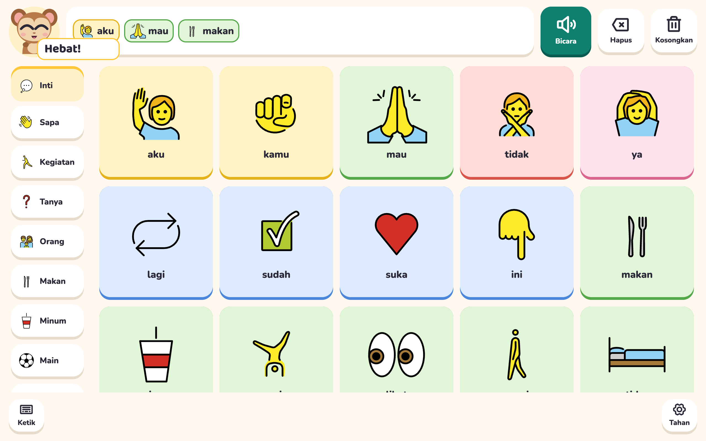
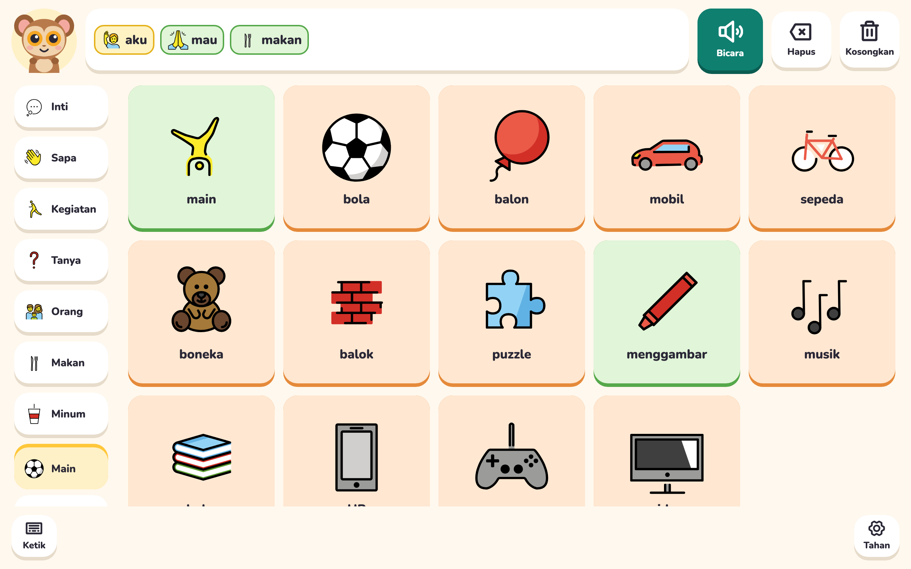
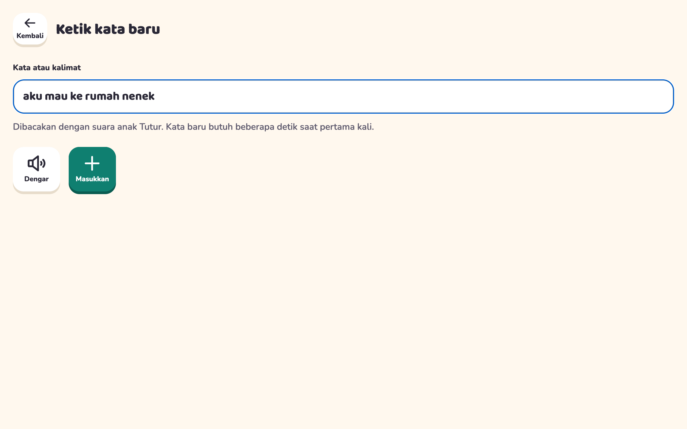
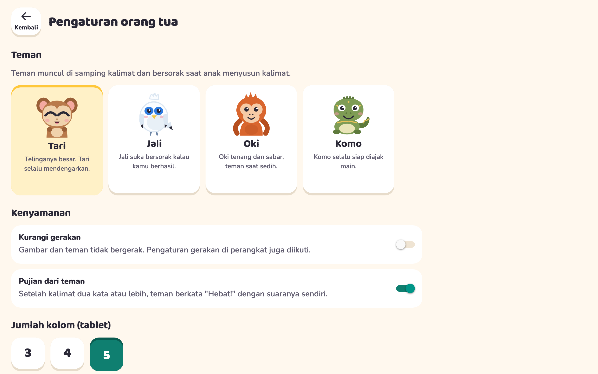
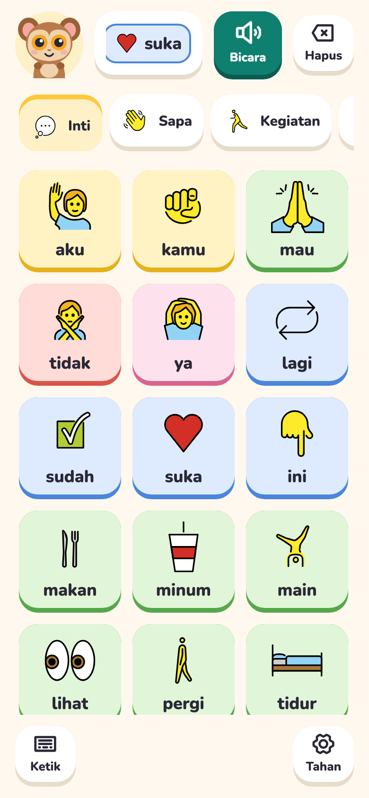

# Tutur

An Indonesian AAC app for children who are learning to speak. The child taps symbols, builds a sentence, and hears it in a natural Bahasa Indonesia voice that sounds the same every time and works offline.



| Play board | Typing a new word | Parent settings |
|---|---|---|
|  |  |  |

<p align="center">
  
</p>

## Layout

| Path | What it is |
|---|---|
| `apps/app` | Expo app (Android, iOS, web). Board, typing screen, parent settings, mascots. |
| `packages/vocab` | Words, boards and mascot phrases. Edit this to change what the child can say. |
| `packages/voice` | Generated speech clips (`clips/`), their `manifest.json`, and the `require()` map the app imports. |
| `packages/symbols` | OpenMoji pictograms used by the boards, copied from the `openmoji` package. |
| `tools/voicegen` | CLI that renders every word through a local VoiceStudio and checks each clip with Whisper. Also runs the voice server for typed text. |

## Commands

```sh
pnpm install
pnpm --filter @tutur/app web      # run the app in a browser
pnpm --filter @tutur/app android  # or ios
pnpm turbo run typecheck lint test
```

## Adding or changing a word

1. Edit `packages/vocab/src/words.ts` and add the id to a board in `categories.ts`. Use `spoken` when the TTS mispronounces the label, for example `{ label: "HP", spoken: "hape" }`.
2. Run `pnpm --filter @tutur/symbols sync` if the word uses a new OpenMoji symbol.
3. Start VoiceStudio, then run `pnpm voicegen`. Only new or changed words are rendered. Pass `--only id,id` or `--force` to regenerate specific clips.
4. Commit the new clips. App builds never need VoiceStudio.

`pnpm voicegen` exits with an error and lists any clip Whisper could not confirm. Listen to those before shipping.

## Fixing a word that sounds wrong

1. `pnpm voicegen --preview kamu,mau` renders 8 takes of each word into `tools/voicegen/preview/index.html`. Open it and listen.
2. Copy the `--pin` command next to the take you like, for example `pnpm voicegen --pin words/kamu=45`. A take you liked in the VoiceStudio app works too: pin the seed shown under Recent takes. The seed is saved in `tools/voicegen/pins.json` and the clip is re-rendered from it.
3. If no take is right, change the word's `spoken` text or `tone` and preview again.
4. `pnpm voicegen --approve words/ayah` marks a clip as checked by ear when Whisper simply can't transcribe it.

## Tone

Each word can set `tone` in `packages/vocab/src/words.ts`: `neutral` (default), `gentle` (for "maaf", "sedih", "capek"), `cheerful` or `firm`. Words are rendered exactly as VoiceStudio's Generate button says them, so a tone only changes how loud the word plays next to the others (`tools/voicegen/src/tones.ts`). To get a different feeling, preview the word and pin the take that carries it best.

## Voices

Each voice is designed once from OmniVoice tags and saved in VoiceStudio as a clone profile (see `tools/voicegen/src/voices.ts`). Every clip is cloned from that one reference, which keeps the voice identical across hundreds of separate generations.

- `Tutur Anak` is the child's voice and reads every board word.
- `Tutur Teman` is the mascot's voice and is used only for praise, so praise never sounds like the child praising themselves.

## Typed words in the child's voice

VoiceStudio does not run on the tablet, so typed words go through a small voice server on the computer that runs VoiceStudio:

```sh
pnpm voice:serve   # listens on port 3910, renders with "Tutur Anak", caches every phrase
```

The app reads the server address from `EXPO_PUBLIC_VOICE_SERVER_URL` (`apps/app/.env`, default `http://localhost:3910` for the browser). For a tablet on the same Wi-Fi, put `EXPO_PUBLIC_VOICE_SERVER_URL=http://<computer-ip>:3910` in `apps/app/.env.local`. When the server can't be reached, the typing screen says so and typed words use the device's own voice instead.

## Icon and web

The app icon, Android adaptive and themed icons, splash, favicon, web manifest icons and the link-preview image are all drawn from Tari in `apps/app/scripts/brand.mts`. Change the drawing there, then run `pnpm --filter @tutur/app brand`.

The web build is pre-rendered (`web.output: "static"`), so search engines and link previews see the title, description, Open Graph tags and structured data without running JavaScript. Page metadata lives in `apps/app/src/seo/metadata.ts`; the typing and parent screens are marked `noindex`. Before deploying, set `EXPO_PUBLIC_SITE_URL` to the site's origin so the canonical URL and preview image are absolute, then run `pnpm --filter @tutur/app exec expo export --platform web`.

## Licences

- Code, mascots and app icon: MIT (`LICENSE`).
- Symbols: [OpenMoji](https://openmoji.org), CC BY-SA 4.0 (`packages/symbols/OPENMOJI-LICENSE.txt`).
- Voices: rendered with OmniVoice (k2-fsa) through VoiceStudio. VoiceStudio is AGPL-3.0. Board clips are pre-rendered, so the app never bundles it. The typed-word voice server does call it over the network, which is fine for local use. Before offering that server to the public, either host the OmniVoice model (Apache-2.0) directly or take VoiceStudio's commercial licence.
